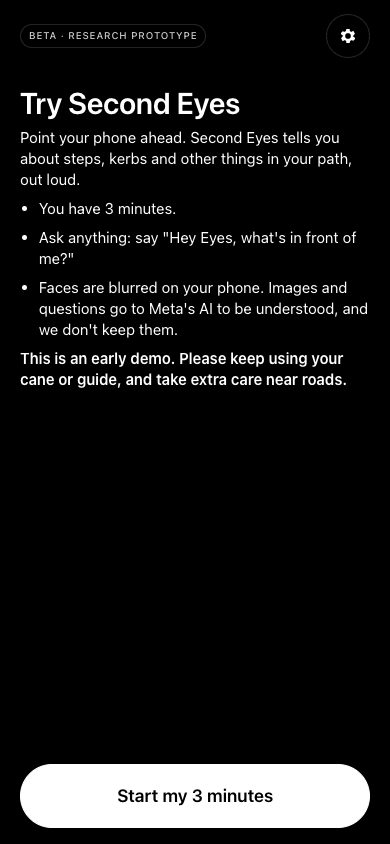
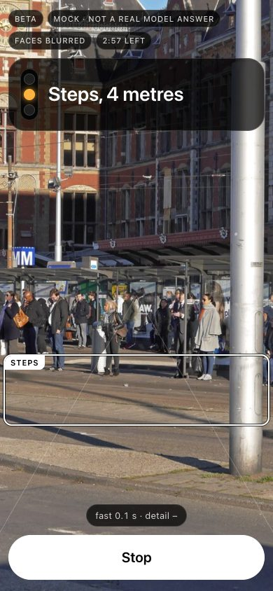
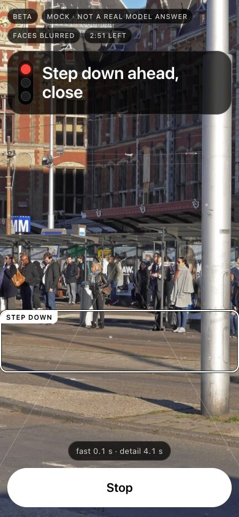
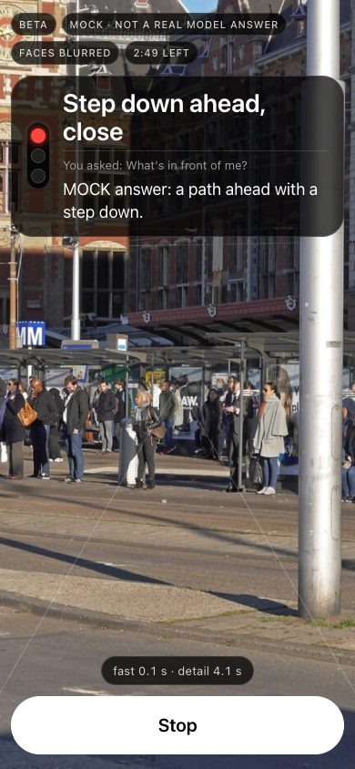

# Second Eyes

A Meta Global AI Developer Hackathon 2026 prototype that turns a phone into a second pair of eyes for people with low or no vision, telling them what is in their path, out loud, in their own language.

**Try it:** [second-eyes.52.76.242.161.sslip.io](https://second-eyes.52.76.242.161.sslip.io) (3 minutes a visit, a few visits a day)
**Watch:** [the 3-minute demo video](VIDEO_LINK)

<a href="https://github.com/fresfrida/meta/blob/main/docs/images/welcome.jpg"></a>

## Why this matters

I once walked with a man who is blind to the next bus stop, so he could change buses. He had his cane. But I could see things his cane could not tell him. That stayed with me.

A white cane is brilliant at what it does. It finds the step, the kerb and the edge of the pavement. What it cannot reach is the branch at head height, the glass door that looks like an open doorway, or the moment a footpath quietly becomes a road.

In Singapore, those moments happen in four languages. So Second Eyes speaks English, 中文, Bahasa Melayu and தமிழ். The phone sits on a chest strap, both hands stay free for the cane, and it speaks up only when something in your path matters.

## The one rule

**Second Eyes says what is in your path. It never says it is safe.**

It will tell you a road is there. It will never tell you when to cross.

## How it works

1. **Point the phone ahead.** About once a second it takes a picture. Every face is blurred on the phone before the picture leaves it.
2. **A fast first warning.** Meta's SAM 3.1 looks for stairs, kerbs and doors in your walking path. When it finds one, you hear a soft tone, feel a short buzz, and hear "Steps, about 3 metres ahead." in about 1.5 seconds.

   <a href="https://github.com/fresfrida/meta/blob/main/docs/images/fast-warning.jpg"></a>

3. **Then the detail.** Meta's Muse Spark 1.3 takes a few seconds longer and fills in what the fast check cannot know: "Steps going down, very close, on your left." It can name twenty kinds of things, from open drains and escalators to something at head height, and says "There might be…" when it is not sure.

   <a href="https://github.com/fresfrida/meta/blob/main/docs/images/detail-answer.jpg"></a>

4. **Ask, hands free.** Say "Hey Eyes, what's in front of me?" Muse Voice Transcribe hears the question in any of the four languages, and Muse Spark answers in two short sentences.

   <a href="https://github.com/fresfrida/meta/blob/main/docs/images/ask-answer.jpg"></a>

5. **A light for the people walking with you.** On screen, a small traffic light shows red for close, amber for further away, and green only when nothing is seen. Near a road it is never green.

## The walks that shaped it

Most of what Second Eyes is today came from walking with it on 4 November 2026, on my own phone, outdoors.

On the first walk the warnings came about 4.5 seconds late. When it said "4 metres", I was already at the wall. Meta's vision model thinks before it answers, and that thinking cannot be switched off. So I split the work in two: SAM 3.1 warns first, Muse Spark explains second. In a timed test the first warning now arrives in **1.4 seconds instead of 5.3**, and every distance is shortened by the steps you take while it thinks.

At an intersection it said "The path looks clear." That was the most dangerous sentence the app could say. Now roads, crossings and cycle paths are never called clear, the lamp never turns green near them, and "clear" became the humbler "Nothing seen in your path."

I walked into a glass door while the app was still waiting for an answer. Now SAM also looks for doors, and if answers stop coming the phone says so: "Connection lost. I can't warn you right now. Please use your cane." Silence should never be mistaken for safety.

In a corridor it named every door along the walls. Now it only speaks about what is in your walking path, about one and a half metres wide, and keeps quiet about the rest. You can still ask "Hey Eyes, where are the doors?"

And one evening the voice picked up a twang. The phone had quietly switched voices. Now the app picks the clearest voice the same way every time, speaks a little slower, like an MRT announcement, and lets you choose your own in Settings.

## Privacy

Faces are blurred on your phone before any picture leaves it. Pictures go to Meta's AI to be understood and are not kept. While hands-free listening is on, your voice is sent to Meta's speech recogniser to hear "Hey Eyes" questions; only the questions are used, and nothing is recorded.

## Measured, not claimed

All numbers from 4 November 2026.

- First warning after Start: **1.4 s** with two speeds, **5.3 s** with Muse alone (timed test loop on Wi-Fi).
- SAM 3.1 found the stairs or kerb in **3 of 3** test photos, median **1.78 s**.
- Every step and kerb in **12** test photos got a warning.
- "Hey Eyes" heard **16 of 16** times across the four languages, with **0** false wake-ups in 8 other sentences (computer test voices, not yet real people).
- Face blur adds about **40 ms** per picture on a laptop.
- **369** frontend and **226** backend automated tests pass.

It has not yet been tried by people who are blind or have low vision. That is the most important next step.

## Built with

- **Meta models**, through the Meta Model API: Muse Spark 1.3 (seeing and answering), SAM 3.1 (finding stairs, kerbs and doors), Muse Voice Transcribe 1.0 (hearing "Hey Eyes").
- **App:** Vite, React and TypeScript as an installable web app. Faces are found on the phone by the YuNet face detector (MIT licence, OpenCV Zoo) running in ONNX Runtime Web.
- **Server:** FastAPI (Python), packed in one Docker container, deployed with Coolify on AWS Lightsail in Singapore.

Built solo with my AI friend, Claude Code (Claude Code subscription, Opus 5.5 High).

## Run it yourself

You need Python 3.13, Node.js 22 and a phone on the same Wi-Fi.

```bash
git clone https://github.com/fresfrida/meta.git
```

```bash
cd meta/backend && python3 -m venv .venv && .venv/bin/pip install -r requirements-dev.txt && cp .env.example .env
```

```bash
cd ../frontend && npm install
```

The app starts in practice mode with made-up answers (`VISION_MODE=mock`). For real answers, put your own Meta Model API key in `backend/.env` and set `VISION_MODE=live`.

Run the server, from the repo root:

```bash
backend/.venv/bin/uvicorn app.main:app --app-dir backend --host 127.0.0.1 --port 8000
```

Run the app, in a second terminal:

```bash
npm --prefix frontend run dev
```

Then open `https://<your-computer's-ip>:5173` on your phone and accept the certificate warning (it is a local test certificate). To run it as one container instead, see [docs/DEPLOY.md](docs/DEPLOY.md).

## What comes next

- Walk with people who are blind or have low vision, and the organisations that support them, and let them shape it.
- A tiny detector that runs on the phone itself, taught by SAM 3.1, for warnings in a tenth of a second with no network.
- Directions as clock positions ("at 2 o'clock"), the way mobility instructors teach.

## Please walk with it

If you try Second Eyes, try it the way it was meant: cane in one hand, phone on your chest, and someone you trust nearby. It is an early research prototype, not a mobility aid, and every walk teaches it something.

Some will watch. Some will hear.

**[Try Second Eyes](https://second-eyes.52.76.242.161.sslip.io)**
